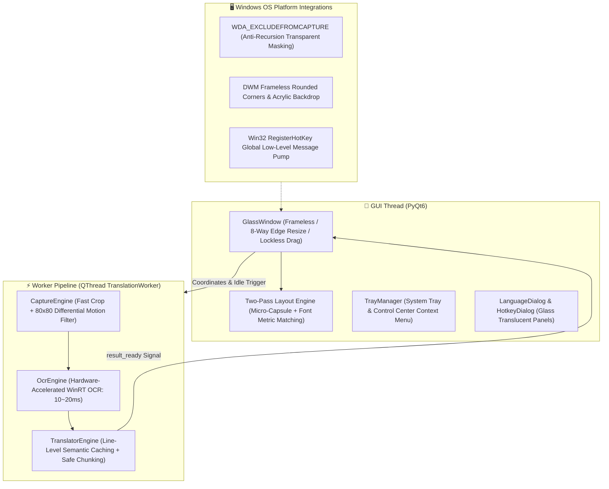

# 🪟 GlassTranslate

<div align="center">

**[English](README_EN.md)** • **[简体中文](../README.md)** • **[日本語](README_JA.md)** • **[한국어](README_KO.md)**

<br/>


-blue)


**The Frameless Transparent Glass Real-Time Translation Lens for Windows**  
*Say goodbye to tedious "screenshot - select - popup reading". Just hover the glass viewfinder over foreign text, and it transforms into your native language in-place!*

[✨ Key Features](#-key-features) • [🚀 Quick Start](#-quick-start) • [🎮 Shortcuts & Controls](#-shortcuts--controls) • [⚙️ Control Menu](#️-control-menu-overview) • [🏗️ Architecture](#️-architecture) • [❓ FAQ](#-faq)

<br/>

<a href="assets/GlassTranslate-Promo.mp4">
  
</a>

**[▶️ Watch the full promo video (46s, Chinese captions)](assets/GlassTranslate-Promo.mp4)**

</div>

---

## 🌟 Why GlassTranslate?

When reading foreign research papers, browsing overseas technical documentation, playing non-localized games, inspecting source code, or watching videos without subtitles, traditional tools force you through a disruptive multi-step workflow: take a screenshot, highlight text, and read from a distracting popup box that obscures your work.

**GlassTranslate** delivers a seamless, physics-based "see-through" lens:
- Place a **100% transparent glass viewfinder** anywhere on your desktop;
- Foreign words inside the frame are **accurately replaced in-place** with clean, typography-matched translated text;
- The underlying background, video stream, and UI elements stay completely visible without jarring occlusion;
- Moving the window clears text instantly like pristine glass, and releasing it yields **instant 0ms cache-hit rendering**!

---

## ✨ Key Features

### 1. 🪟 Pure Minimalist Transparent Glass
- **No title bar, no intrusive border frames**: 100% transparent window body with subtle cyan focus corner indicators.
- **In-Place Typography-Matched Replacement**: Reads physical screen coordinates of detected lines, dynamically samples background luminosity and hue, and renders micro-capsule backgrounds with optimal contrast in a robust Two-Pass pipeline.
- **Intuitive Glass Physics**: Left-click anywhere inside the frame to drag smoothly. The frame wipes clean while moving and re-anchors translations seamlessly upon release.

### 2. ⚡ 0.6s Cold Start & Zero Console Flickering
- **No Temp Unpacking Delays**: Unlike traditional `--onefile` packaging that unpacks 70MB of DLLs into `AppData/Local/Temp` on every launch, the optimized standalone distribution launches instantly in **~0.6s**.
- **Pure Native GUI**: Console black boxes (`cmd.exe`) are suppressed from the earliest hook, ensuring a clean Windows desktop experience.
- **Parallel Background Pre-Warming**: The UI renders within 100ms, while heavy OCR and network engines warm up concurrently in background worker threads.

### 3. 🌐 12 Language Presets & Free Multilingual Dialog
- **12 Quick-Access Presets**: Instantly switch between English ➔ Chinese, Japanese ➔ Chinese, Korean ➔ Chinese, French ➔ Chinese, German ➔ Chinese, Russian ➔ Chinese, Spanish ➔ Chinese, Chinese ➔ English, Chinese ➔ Japanese, Chinese ➔ Korean, Auto ➔ English, and more.
- **`LanguageDialog` Custom Chooser**: Select freely from 14+ source languages and 11+ target languages with a single-click bidirectional swap button (`⇄`).
- **Dynamic WinRT OCR Language Matching**: Automatically resolves system-installed language packs (French, German, Russian, Spanish, Italian, Portuguese, Japanese, Korean, Chinese, English, etc.) without rigid hardcoding.

### 4. ⌨️ Global Hotkey Summon & Hot-Reload
- **Preset Quick Selection**: Defaults to `Alt+R`, with built-in presets for `Alt+Q`, `Alt+W`, `Alt+D`, `Alt+Space`, `Ctrl+Shift+R`, and `F4`.
- **Interactive Key Recording**: Built-in hotkey configuration dialog allows pressing any key combination to record dynamically.
- **Zero-Restart Hot-Reloading**: Switches Win32 system-wide hooks seamlessly on the fly.

### 5. 📑 Long Paragraph Auto-Chunking & Line Alignment
- **Strict Chunk Size Bounds**: Dynamically partitions large articles into safe micro-chunks (<=360 chars), eliminating API silent truncation on trailing sentences.
- **Line Count Parity & Targeted Repair**: If multi-line translations return differing line splits, matching lines are immediately preserved while unaligned lines receive pinpoint re-translation, ensuring 100% complete coverage without dropped sentences.

### 6. 🧠 Line-Level Persistent Semantic Caching
- **0ms Re-Render on Micro-Adjustments**: Caches translations not only at the full-block MD5 level, but also down to per-line semantic fingerprints.
- **Diacritic & Punctuation Fault Tolerance**: Employs `unicodedata` NFKD diacritic folding (e.g., `à->a`, `é->e`) so slight window jitters or punctuation shifts still achieve **100% instant cache hits** with zero network delay.

### 7. 🚀 Millisecond Dual-Channel Translation Pipeline
- **Windows Hardware-Accelerated OCR**: Native WinRT OCR processes high-resolution crops in **10~20ms** with virtually zero CPU overhead.
- **Key-Free Default Channel**: The Youdao mobile web endpoint typically responds in **50~90ms** and is less prone to `411` throttling than the aidemo endpoint.
- **Multi-Tier Automated Failover**: Mobile Gateway ➔ aidemo (30s cool-down after throttling) ➔ MyMemory Multilingual Fallback.

> ⚠️ **About the default channel**: The default Youdao channel uses Youdao's public web endpoint, **not an official open API**. It works without a key, but heavy use may be rate-limited, and it can break if the website changes. For long-term reliability, open **🔑 Custom API Settings...** from the right-click menu and connect an LLM such as DeepSeek or OpenAI, or a local Ollama model (fully offline).

### 8. 🖱️ 8-Direction Edge Resizing & In-Frame Wheel Zoom
- **Smooth Edge Sensing**: Hovering within 14px of any edge or corner smoothly transitions the cursor to resize handles.
- **Anchor-Centered Wheel Zooming**: Scroll the mouse wheel inside the frame to expand or shrink the capture boundary centered around your cursor.

> 📦 **Zero-Config Prebuilt Binary**: For non-technical users, no Python installation is required! Head over to [👉 GitHub Releases](https://github.com/newHashub/glass_translate/releases) to download `GlassTranslate-v1.0.0-Windows-x64.zip` and run it out-of-the-box!

---

## 🚀 Quick Start

Choose your preferred way based on your needs:

### Option 1: Prebuilt Portable Package (Recommended for Non-Coders)

No Python or environment setup required:
1. Go to [👉 Releases Page](https://github.com/newHashub/glass_translate/releases).
2. Download the precompiled archive **`GlassTranslate-v1.0.0-Windows-x64.zip`**.
3. Extract it to any directory on your computer (e.g. `D:\GlassTranslate`).
4. Double-click **`一键生成桌面快捷方式.vbs`** to generate the desktop shortcut with application icon, or double-click **`GlassTranslate.exe`** directly to launch instantly!

---

### Option 2: Run from Source (For Developers)

For developers looking to inspect source code or contribute:

#### 1. Requirements
- **OS**: Windows 10 (Build 19041+) or Windows 11 (64-bit)
- **Python**: Python 3.10+ (Python 3.12 recommended)

#### 2. Clone & Install Dependencies
```bash
git clone https://github.com/newHashub/glass_translate.git
cd glass_translate
pip install -r requirements.txt
```

#### 3. Run Application
- **Convenient Script**: Double-click **`run.bat`** (auto-detects Python environment, launches quietly with zero console window).
- **Command Line**:
  ```powershell
  python main.py
  ```

---

### 📦 Build Standalone Executable (For Developers)
To recompile the standalone native executable after modifying code:
- Run **`build_exe.bat`** in the project root.
- The script automatically:
  1. Compiles the native app into `dist\GlassTranslate\`;
  2. Updates/creates the **`GlassTranslate.lnk`** shortcut on your Windows desktop;
  3. Generates the ready-to-distribute archive `dist\GlassTranslate-v1.0.0-Windows-x64.zip`.

---

## 🎮 Shortcuts & Controls

| Shortcut / Action | Description |
| :--- | :--- |
| **Alt + R (or custom hotkey)** | **Global Summon/Dismiss**: Show or hide the translation viewfinder at cursor position |
| **Alt + S (or custom hotkey)** | **Region Select**: The screen dims; drag a rectangle with the left button and the viewfinder snaps to it and translates immediately. Esc or right-click to cancel |
| **Left-Click & Drag Inside Frame** | Smoothly moves the lens; clears frame on press and anchors translated text on release |
| **Hover & Drag on Edges/Corners** | 8-direction smooth sizing of the lens viewport |
| **Mouse Wheel Inside Frame** | Fast anchor-centered zooming of viewfinder size (toggleable in menu) |
| **Right-Click Inside Frame** | Opens the comprehensive Control Center menu |
| **Double-Click System Tray Icon** | Toggle show/hide for the translation window |

---

## ⚙️ Control Menu Overview

Right-click anywhere inside the frame or on the tray icon in the Windows taskbar:

- 🪟 **Show / Hide Viewfinder**
- ⏸️ **Real-time Auto Translation** (Enable/Pause automated scanning)
- ⚡ **Recognize Now** (Manually trigger a fresh capture)
- ✂️ **Select Region to Translate** (same as `Alt + S`)
- 🌐 **Translation Languages ➔** (12 quick presets, plus **`⚙️ Custom Language Selection...`** for free pairing)
- 🚀 **Translation Engine ➔** (⚡ Youdao Web Channel [Default], 🌐 MyMemory Free Channel, 🤖 Custom LLM API)
- 🔤 **Display Mode ➔** (In-Place Text Replacement [Default] / Floating Subtitle Card)
- 🔍 **Font Scale ➔** (Compact 85%, Standard 100%, Larger 115%, Bold 130%)
- ⏱️ **Scan Interval ➔** (Fast 200ms, Balanced 300ms [Default], Eco 600ms, Relaxed 1000ms)
- ⌨️ **Summon Hotkey ➔** (Select presets or open visual keybinding recorder)
- 🖱️ **In-Frame Mouse Wheel Zoom** (Toggle on/off)
- 💡 **Show Status Pill** (Toggle bottom indicator pill)
- 📌 **Always on Top** (Keep viewfinder pinned over other windows)
- 📋 **Copy Latest Translation**
- 🔑 **Custom LLM API Settings...** (Configure endpoint, key, and model for OpenAI, DeepSeek, or Ollama)
- ❌ **Exit Application**

---

## 🏗️ Architecture



### Directory Tree
```
glass_translate/
├── main.py                  # Entry point for both source runs and packaging; forwards to src/main.py
├── src/
│   ├── main.py              # Startup (hidden console, tray, global hotkeys, lifecycle)
│   ├── glass_window.py      # Transparent viewfinder, adaptive layout, dialogs
│   ├── region_select.py     # Full-screen overlay for Alt+S region select (multi-monitor)
│   ├── worker.py            # Background worker (change detection, cache probe, pre-warming)
│   ├── capture_engine.py    # Screen capture & pixel-diff change detection
│   ├── ocr_engine.py        # Windows native OCR wrapper & "Auto" language detection
│   ├── translator_engine.py # Multi-channel translation (chunking, line-level cache)
│   ├── global_hotkey.py     # Win32 RegisterHotKey listener thread
│   ├── tray_manager.py      # Tray icon & right-click control menu
│   ├── win32_utils.py       # Capture exclusion, DWM styling, high-DPI awareness
│   └── config.py            # Settings persistence
├── resources/app_icon.ico   # App icon
├── scripts/                 # Shortcut, release packaging and silent launch scripts
├── docs/                    # Translated READMEs, comparison, demo assets
├── tests/                   # pytest suite (runs offline)
├── run.bat                  # Launcher (prefers the packaged exe)
├── build_exe.bat            # One-click build: exe, shortcut, release ZIP
└── requirements.txt         # Python dependencies
```

---

## 🧪 Testing

Run the automated test suite:
```powershell
pytest -v
```

---

## ❓ FAQ

**Q: Can I use this for playing foreign games or watching videos?**  
A: Yes! Simply place the transparent window over subtitles or game dialogues. Thanks to `WDA_EXCLUDEFROMCAPTURE`, the translation window itself is invisible to the capture engine, completely avoiding self-capture loops.

**Q: What if the translation doesn't match my target language?**  
A: Open the right-click menu, select **🌐 Translation Languages**, and pick any of the 12 presets or click **⚙️ Custom Language Selection...** to pair any source and target language freely.

**Q: Do I need an API key? Is the default channel reliable?**  
A: No key is needed. However, the default Youdao channel relies on a public web endpoint rather than an official API, so it may be throttled under heavy use or stop working if the site changes. For dependable daily use, configure your own LLM key or a local Ollama model as described below.

**Q: I chose "Auto" but only English is recognized. Why not Japanese or Korean?**  
A: "Auto" picks the best of the installed English, Japanese, Chinese and Korean OCR recognizers, and handles mixed text such as Korean with English. But Windows only ships OCR recognizers for the languages you have installed. To add one, go to **Settings → Time & language → Language & region → Add a language**, choose Japanese or Korean, and make sure "Optical character recognition" is included. You don't need to change your display language.

**Q: Can I connect to DeepSeek or a local Ollama model?**  
A: Absolutely! Right-click and choose **🔑 Custom API Settings...**, select OpenAI compatibility, and enter your endpoint URL (e.g., `http://localhost:11434/v1/chat/completions` for Ollama or `https://api.deepseek.com/v1/chat/completions`).

---

## 📄 License

This project is licensed under the [MIT License](LICENSE).
